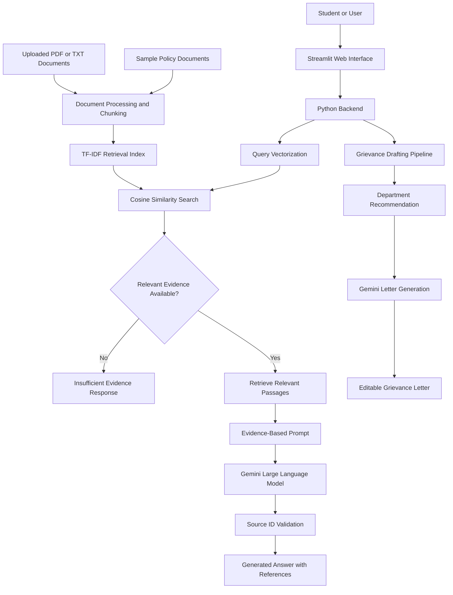

# 🎓 CampusResolve AI

### An Intelligent University Student Support and Grievance Assistance System Using Generative AI and RAG


## Project Overview

CampusResolve AI is a Generative AI-powered university student support system designed to simplify access to academic policies, administrative information and grievance procedures.

The application combines Google's Gemini Large Language Model (LLM) with Retrieval-Augmented Generation (RAG) to generate context-grounded responses using relevant policy documents.

It also assists students in identifying appropriate university departments and generating professional grievance letters.

The system is university-independent and can be adapted to different educational institutions by uploading their verified policy documents.

---

## Problem Statement

Students often face difficulties accessing accurate information regarding attendance, examinations, scholarships, internships, fee payments and administrative procedures.

University information is frequently distributed across different documents, circulars, websites and departments. This can lead to confusion, delays and unnecessary administrative visits.

Conventional AI chatbots may also generate inaccurate or unsupported responses when answering institution-specific questions.

CampusResolve AI addresses these challenges by providing a centralized, evidence-based student assistance platform using Generative AI and document retrieval.

---

## Project Objectives

- Simplify access to university policies and academic information.
- Generate relevant responses using Large Language Models.
- Reduce unsupported AI-generated information through document grounding.
- Recommend appropriate university departments for student concerns.
- Generate professional and editable grievance letters.
- Support dynamic integration of university policy documents.
- Evaluate information retrieval performance and unsupported query handling.

---

## Key Features

| Feature | Description |
|---|---|
| Intelligent Question Answering | Provides document-grounded answers to university-related questions. |
| Retrieval-Augmented Generation | Retrieves relevant policy passages before generating responses. |
| Grievance Letter Generation | Converts student concerns into professional complaint letters. |
| Department Recommendation | Suggests a relevant administrative department based on retrieved information. |
| Dynamic Document Upload | Supports uploading PDF and TXT policy documents. |
| Source References | Displays retrieved evidence alongside generated responses. |
| Unsupported Query Handling | Abstains when insufficient relevant evidence is retrieved. |
| Evaluation Dashboard | Measures retrieval category accuracy and out-of-scope abstention. |
| Offline Demo Mode | Supports extractive responses and template-based grievance drafting without API calls. |
| Live Gemini Mode | Enables actual LLM-based answer and grievance generation. |

---

## GenAI and LLM Concepts Implemented

- Generative Artificial Intelligence
- Large Language Models (LLMs)
- Retrieval-Augmented Generation (RAG)
- Prompt Engineering
- Context-Grounded Text Generation
- Natural Language Processing
- Document Chunking
- Information Retrieval
- TF-IDF Vectorization
- Cosine Similarity
- Hallucination Mitigation
- Selective Response Abstention
- LLM API Integration
- AI Performance Evaluation

The system uses TF-IDF and cosine similarity for lightweight document retrieval. Retrieved passages are supplied to Gemini as contextual evidence for response generation.

No custom LLM training or fine-tuning is required.

---

## Technology Stack

| Technology | Purpose |
|---|---|
| Python | Core application development |
| Streamlit | Interactive web interface |
| Google Gemini | Large Language Model and text generation |
| Scikit-learn | TF-IDF vectorization and similarity search |
| PyPDF | PDF document extraction |
| Requests | Gemini API communication |
| JSON | Structured evaluation datasets |
| Pytest | Automated backend testing |
| Git and GitHub | Version control and source code management |

---

## System Architecture



The architecture represents the live generation workflow. Offline mode uses extractive retrieval and template-based drafting instead of Gemini generation.

---

## Application Modules

### 1. Ask CampusResolve

Students can enter questions related to university policies and administrative services.

The system retrieves relevant document passages and generates responses supported by source references.

Example:

**Input:** How can I obtain an internship NOC?

**Output:** Relevant internship approval procedures, required documentation and department guidance based on the available policy documents.

### 2. Grievance Letter Generator

Students can describe an academic or administrative issue in natural language.

The system recommends an appropriate department and generates a professional grievance letter that can be reviewed, edited and downloaded.

Example:

**Input:** I accidentally paid my semester fees twice and would like to request a refund.

**Output:** A formal grievance letter addressed to the Finance Office.

The application assists with drafting only and does not automatically submit complaints.

### 3. Dynamic Knowledge Base

Users can upload university policy documents in PDF or TXT format.

The application extracts and processes document text, allowing newly uploaded information to be retrieved without retraining the LLM.

### 4. Evaluation Dashboard

The evaluation module measures retrieval category accuracy and out-of-scope query abstention using the bundled benchmark dataset.

Users can also inspect the knowledge base and retrieved policy passages.

---

## Dataset Description

The project includes 10 synthetic university policy documents covering common academic and administrative concerns.

| Dataset Category | Information Covered |
|---|---|
| Attendance | Attendance issues and correction procedures |
| Examination | Revaluation, hall tickets and examination procedures |
| Scholarship | Financial assistance and scholarship guidance |
| Internship | Internship approval and NOC procedures |
| Fees | Payment issues and refund requests |
| Grievance | Complaint submission and escalation |
| Placement | Recruitment and placement registration |
| Student Welfare | Student support and welfare services |
| Library | Book renewal, returns and fines |
| Academic Records | Certificates and academic documentation |

### Evaluation Dataset

| Dataset Component | Quantity |
|---|---:|
| Synthetic Policy Documents | 10 |
| Labelled Benchmark Queries | 100 |
| Out-of-Scope Test Queries | 5 |

The included policy documents are synthetic and intended for educational demonstration. They do not represent the official regulations of any particular university.

For institution-specific use, disable the synthetic sample policies and upload verified university documents.

---

## Project Folder Structure

```text
CampusResolve_AI/
│
├── app.py
├── engine.py
├── evaluate.py
├── build_data.py
├── requirements.txt
├── configure_key.bat
├── start_windows.bat
├── README.md
├── DEMO_AND_VIVA.md
├── .gitignore
│
├── data/
│   ├── academic_records.txt
│   ├── attendance.txt
│   ├── examination.txt
│   ├── fees.txt
│   ├── grievance.txt
│   ├── internship.txt
│   ├── library.txt
│   ├── placement.txt
│   ├── scholarship.txt
│   ├── student_welfare.txt
│   ├── evaluation_dataset.json
│   └── out_of_scope.json
│
└── tests/
    └── test_engine.py
```

---

## Installation and Execution

### Prerequisites

- Python 3.11 or 3.12 recommended
- Git
- Internet connection for dependency installation and live generation
- Google Gemini API key for live LLM functionality

### Step 1: Clone the Repository

```bash
git clone https://github.com/swathi-pr7/CampusResolve-AI.git
cd CampusResolve-AI
```

### Step 2: Create a Virtual Environment

```bash
python -m venv .venv
```

### Step 3: Install Dependencies

Windows:

```powershell
.\.venv\Scripts\python.exe -m pip install -r requirements.txt
```

macOS or Linux:

```bash
.venv/bin/python -m pip install -r requirements.txt
```

### Step 4: Configure the Gemini API Key

Obtain an API key from Google AI Studio:

https://aistudio.google.com/apikey

On Windows, execute:

```powershell
.\configure_key.bat
```

Enter the API key when prompted.

Alternatively, enter the API key directly into the application's sidebar after selecting Live Gemini LLM mode.

The application also supports the GEMINI_API_KEY environment variable.

Never hardcode API credentials into source files or commit them to GitHub.

### Step 5: Run the Application

Windows:

```powershell
.\.venv\Scripts\python.exe -m streamlit run app.py
```

macOS or Linux:

```bash
.venv/bin/python -m streamlit run app.py
```

Open the application in your browser:

http://localhost:8501

The included start_windows.bat file also supports automated Windows setup and execution.

---

## Generation Modes

| Feature | Offline Demo | Live Gemini LLM |
|---|---|---|
| API Key Required | No | Yes |
| Document Retrieval | Yes | Yes |
| Source References | Yes | Yes |
| LLM-Based Generation | No | Yes |
| Grievance Drafting | Template-based | AI-generated |
| Internet During Generation | No | Yes |

The default Gemini model configured in the application is gemini-2.5-flash. Model availability and usage quotas depend on the user's Google account.

---

## Sample Test Queries

- How can I obtain an internship NOC?
- How can I apply for examination revaluation?
- I accidentally paid my semester fees twice. What should I do?
- How can I obtain a bonafide certificate?
- What documents are required for a scholarship application?
- How can I submit a formal university grievance?
- How can I renew a library book?
- Whom should I contact regarding incorrect attendance?

The system can also be tested with unrelated questions to evaluate insufficient-evidence handling.

---

## Performance Evaluation

The initial backend evaluation produced the following results:

| Evaluation Metric | Result |
|---|---:|
| Top-1 Retrieval Category Accuracy | 94% |
| Correct Category Predictions | 94/100 |
| Out-of-Scope Abstention | 5/5 (100%) |
| Automated Backend Tests | 5/5 Passed |

These results were obtained using the bundled synthetic benchmark.

The retrieval category accuracy measures whether the system identifies the expected document category. It does not represent overall Gemini answer accuracy.

The out-of-scope evaluation contains only five test questions and does not establish universal hallucination prevention.

### Run Automated Tests

Windows:

```powershell
.\.venv\Scripts\python.exe -m pytest -q
```

### Run Retrieval Benchmark

```powershell
.\.venv\Scripts\python.exe evaluate.py
```

The benchmark can also be executed through the Evaluation & Knowledge Base tab in the application.

---

## Educational and Societal Impact

CampusResolve AI aims to improve accessibility to academic and administrative information within educational institutions.

Potential benefits include:

- Reduced confusion regarding university procedures.
- Faster access to relevant academic information.
- Improved student awareness of administrative services.
- Assistance in preparing professional grievance letters.
- Reduced dependence on repetitive manual enquiries.
- Improved transparency through source-referenced responses.
- Adaptability to different universities and educational institutions.

The application supports informed student decision-making but does not replace official university authorities.

---

## Research Perspective

The project explores the use of Retrieval-Augmented Generation and evidence-based response generation to improve the reliability of LLM-powered university assistance systems.

Potential research extensions include comparing:

1. Conventional LLM responses without document retrieval.
2. LLM responses using standard RAG.
3. RAG-based responses with evidence checks and selective abstention.

Future experiments can evaluate answer correctness, hallucination rates, citation faithfulness, department recommendation accuracy and response latency.

These comparative LLM experiments are proposed future research and are not part of the current retrieval benchmark results.

---

## Limitations and Privacy

- The bundled policy dataset is synthetic.
- TF-IDF retrieval may struggle with complex paraphrased or ambiguous questions.
- Retrieval similarity scores are not probabilities of answer correctness.
- Source ID validation does not guarantee semantic faithfulness.
- Live generation requires a valid Gemini API key and internet connectivity.
- Scanned PDFs require external OCR processing.
- The application does not automatically submit grievances or process administrative requests.
- No persistent student account or grievance tracking database is implemented.
- Live mode sends prompts and relevant document passages to Google.
- Users should avoid submitting sensitive personal information or confidential documents.

CampusResolve AI is an educational prototype. Official university rules and deadlines should be verified before taking administrative action.

---

## Future Enhancements

- Integration of verified university policy datasets.
- Semantic retrieval using neural text embeddings.
- Comparative LLM and RAG performance evaluation.
- Improved citation faithfulness verification.
- Multilingual student assistance.
- OCR support for scanned university documents.
- Secure student authentication.
- Grievance status tracking.
- Integration with university administrative systems.

---

## Author

**Swathi P R**

Master of Computer Applications (MCA)

GitHub: [swathi-pr7](https://github.com/swathi-pr7)

---

## Project Purpose

This project was developed for academic and research-oriented exploration of Generative AI, Large Language Models and Retrieval-Augmented Generation in the education domain.
